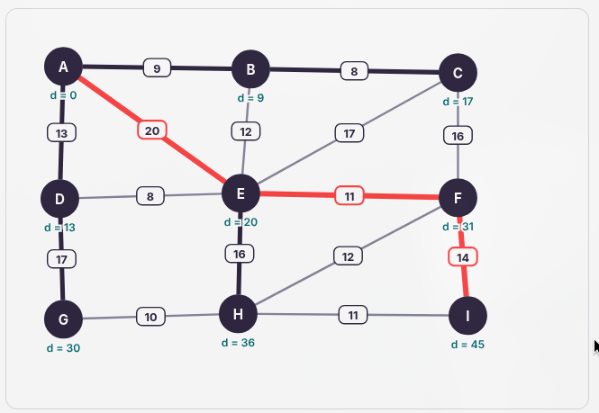
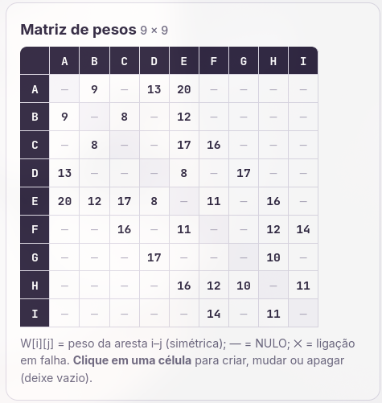
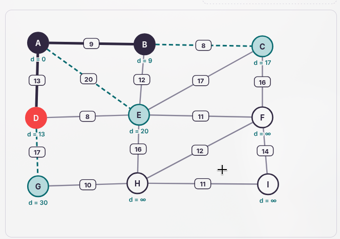
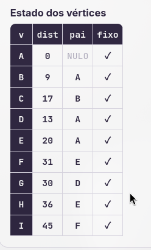
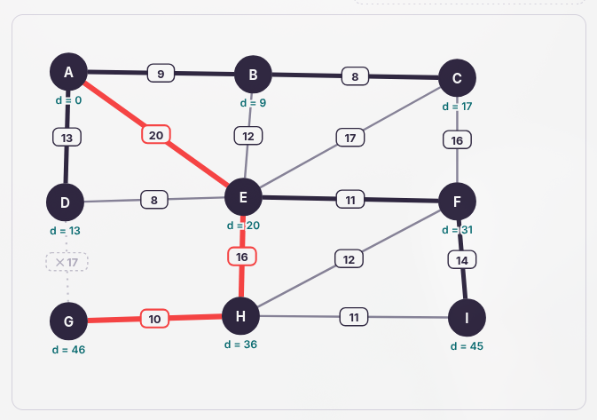
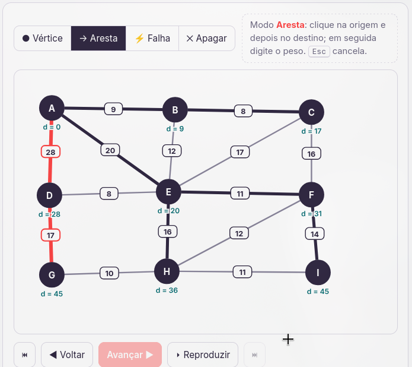
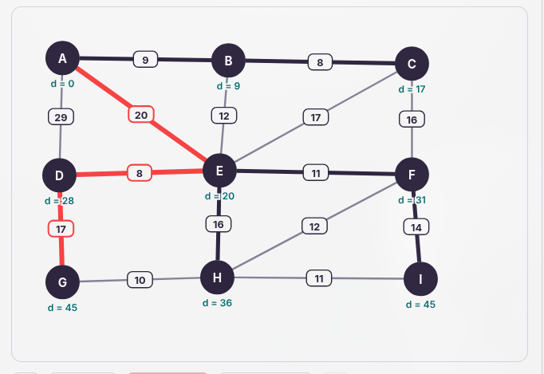
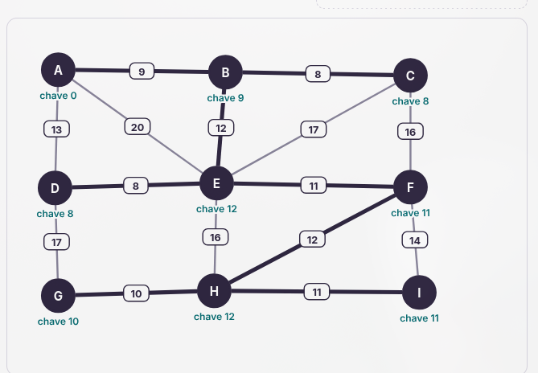
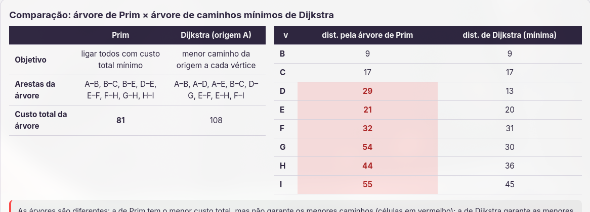

Felipe Caiafa Alvim Soares

# Etapa 1 - Modelagem formal e matriz de pesos

Dígitos do RA 

| D1 | D2 | D3 | D4 | D5 | D6 |
|---|---|---|---|---|---|
| 5 | 1 | 0 | 1 | 0 | 8 |

1. Pesos calculados (Modelo de tabela utilizado do repositorio de estudo proprio)

| Aresta | Ramal | Fórmula | Cálculo | w (km) |
|---|---|---|---|---|
| e1 | (A, B) | 9 + (D1 mod 5) | 9 + (5 mod 5) = 9 + 0 | **9** |
| e2 | (A, D) | 12 + (D2 mod 6) | 12 + (1 mod 6) = 12 + 1 | **13** |
| e3 | (A, E) | 20 + (D3 mod 7) | 20 + (0 mod 7) = 20 + 0 | **20** |
| e4 | (B, C) | 7 + (D4 mod 4) | 7 + (1 mod 6) = 7 + 1 | **8** |
| e5 | (B, E) | 10 + ((D5+D6)) mod 6) | 10 + (8 mod 5) = 10 + 2 | **12** |
| e6 | (C, F) | 13 + (D6 mod 5) | 13 + (8 mod 5) = 13 + 3 | **16** |
| e7 | (D, E) | 8 + ((D1+D3) mod 5) | 8 + (5 mod 5) = 8 + 0 | **8** |
| e8 | (D, G) | 15 + ((D2+D4) mod 6) | 15 + (2 mod 6) = 15 + 2 | **17** |
| e9 | (E, F) | 11 + ((D3+D5) mod 4) | 11 + (0 mod 4) = 11 + 0 | **11** |
| e10 | (E, H) | 14 + ((D4+D6) mod 7) | 14 + (9 mod 7) = 14 + 2 | **16** |
| e11 | (F, I) | 9 + ((D1+D5) mod 6) | 9 + (5 mod 8) = 9 + 5 | **14** |
| e12 | (G, H) | 6 + ((D2+D6) mod 5) | 6 + (9 mod 5) = 6 + 4 | **10** |
| e13 | (H, I) | 10 + ((D3+D4) mod 6) | 10 + (1 mod 4) = 10 + 1 | **11** |
| e14 | (C, E) | 16 + ((D1+D2) mod 5) | 16 + (6 mod 5) = 16 + 1 | **17** |
| e15 | (F, H) | 12 + (D5 mod 7) | 12 + (0 mod 7) = 12 + 0 | **12** |

2. Diagrama topológico

3.  Matriz de pesos 9x9

4. Simulador:

5. Perguntas:

a) A matriz é 9x9, então tem 81 células, tirando a diagonal sobram 72. Como cada ramal aparece 2 vezes , são 30 células com peso, então sobram 42 células com — (sem nada). Não depende do RA porque o RA só muda o valor dos pesos, as ligações são sempre as mesmas 15.

b) A = 3, B = 3, C = 3, D = 3, E = 6, F = 4, G = 2, H = 4, I = 2. Somando da 30, que é igual a 2 x 15 = 30.

c) A subestação E, com grau 6. Isso indica que ela é o ponto mais crítico da rede, se ela cair muitas rotas são afetadas, inclusive a minha (A-E-F-I).

# Etapa 2 - Dijsktra

1. Teste de Mesa (Modelo de tabela utilizado do repositorio de estudo próprio):

| It. | u | L[u] | A | B | C | D | E | F | G | H | I | Antecessores atualizados |
|---|---|---|---|---|---|---|---|---|---|---|---|---|
| Inic. | — | — | 0 | inf | inf | inf | inf | inf | inf | inf | inf | Inicialização na origem A |
| 1 | A | 0 | [0] | 9 | inf | 13 | 20 | inf | inf | inf | inf | Ant[B] = A, Ant[D] = A, Ant[E] = A |
| 2 | B | 9 | [0] | [9] | 17 | 13 | 20 | inf | inf | inf | inf | Ant[C] = B (E: 9 + 12 = 21 ≥ 20, mantém) |
| 3 | D | 13 | [0] | [9] | 17 | [13] | 20 | inf | 30 | inf | inf | Ant[G] = D (E: 13 + 8 = 21 ≥ 20, mantém) |
| 4 | C | 17 | [0] | [9] | [17] | [13] | 20 | 33 | 30 | inf | inf | Ant[F] = C (E: 17 + 17 = 34 ≥ 20, mantém) |
| 5 | E | 20 | [0] | [9] | [17] | [13] | [20] | 31 | 30 | 36 | inf | Ant[F] = E (20 + 11 = 31 < 33), Ant[H] = E |
| 6 | G | 30 | [0] | [9] | [17] | [13] | [20] | 31 | [30] | 36 | inf | nenhum (H: 30 + 10 = 40 ≥ 36, mantém), destino fechado |
| 7 | F | 31 | [0] | [9] | [17] | [13] | [20] | [31] | [30] | 36 | 45 | Ant[I] = F (H: 31 + 12 = 43 ≥ 36, mantém) |
| 8 | H | 36 | [0] | [9] | [17] | [13] | [20] | [31] | [30] | [36] | 45 | nenhum (I: 36 + 11 = 47 ≥ 45, mantém) |
| 9 | I | 45 | [0] | [9] | [17] | [13] | [20] | [31] | [30] | [36] | [45] | nenhum |

2. Execução no simulador:

Nessa etapa entendi que a terceira aresta seria a partir do momento que tivessem 3 arestas ja na cor mais escura, mas por preucausão anexei a imagem onde tem 3 conectadas. Ou seja abaixo tem a imagem onde tem 3 arestas ja identificadas e 4 vertices, porem entendi como se o primeiro nao fosse considerado.

3. Registro das relaxações:

k = (D4 mod 3) + 3 = (1 mod 3) + 3 = 4, então a iteração 4, que fecha o C com dist = 17.

- B: já esta la
- E: 17 + 17 = 34, comparando com dist[E] = 20, 34 ≥ 20, mantém.
- F: 17 + 16 = 33, comparando com dist[F] = inf, 33 < inf, relaxa, dist[F] = 33 e pai[F] = C.

Quando um vertice é fixado a distância dele já é a menor possível, então meio que não tem como melhorar

4. Confronto mesa x simulador:

A ordem de fechamento foi a mesma nos dois (A, B, D, C, E, G, F, H, I), e os valores de L e os antecessores também bateram com a tabela "Estado dos vértices" do simulador. Então não teve divergência.

# Etapa 3 - Contingencia com o modo Falha

Questão 1: A distância total minima é de 30 KM e a sequencia seria A-D-G.

Questão 2: 

A-D Derrubado:
Derrubei o A-D, o caminho mudou para A-E-D-G, com um distancia que agora de 45 KM que seria 15 a mais que o minimo.

D-G Derrubado:
Com o D-G Derrubado, o caminho mudou para A-E-H-G, com uma distancia que agora foi para 46 KM que seria 16 a mais que o minimo.

Questão 3: O primeiro ramal da rota é A-D (13 KM). Fui aumentando o peso e o maior Δ foi 15. Com o A-D em 28 (w + Δ) o caminho continua A-D-G, com 45 KM. Com 29 (w + Δ + 1) o caminho muda para A-E-D-G e o custo para de subir, fica em 45 KM.

O Δ deu igual ao acréscimo da questão 2 quando derrubei o A-D (15 KM). Isso porque derrubar o ramal é como se o peso dele fosse infinito, então o caminho só troca quando passar pelo A-D fica mais caro que o melhor caminho sem ele (45 KM). Ou seja, a folga é 45 - 30 = 15.

Questão 4: Coloquei em falha todos os ramais do vertice E

| Subestação | Antes | Depois | Diferença |
|---|---|---|---|
| A | 0 | 0 | 0 |
| B | 9 | 9 | 0 |
| C | 17 | 17 | 0 |
| D | 13 | 13 | 0 |
| E | 20 | inf | ficou isolada |
| F | 31 | 33 | +2 |
| G | 30 | 30 | 0 |
| H | 36 | 40 | +4 |
| I | 45 | 47 | +2 |

Pioraram o F (+2, agora vai por A-B-C-F), o H (+4, agora vai por A-D-G-H) e o I (+2, agora vai por A-B-C-F-I). O E ficou sem ligação nenhuma.

Minha rota até o G não mudou, continua A-D-G com 30 KM, porque ela não passa pelo E.

# Etapa 4 - Prim x Dijkstra

Questão 1:

| Passo | Vértice | Aresta | Chave |
|---|---|---|---|
| 1 | A | — | 0 |
| 2 | B | A-B | 9 |
| 3 | C | B-C | 8 |
| 4 | E | B-E | 12 |
| 5 | D | D-E | 8 |
| 6 | F | E-F | 11 |
| 7 | H | F-H | 12 |
| 8 | G | G-H | 10 |
| 9 | I | H-I | 11 |

Custo total da arvore minima: 9 + 8 + 12 + 8 + 11 + 12 + 10 + 11 = 81 KM.

Questão 2:

Prim: A-B, B-C, B-E, D-E, E-F, F-H, G-H, H-I, custo 81 KM.

Dijkstra: A-B, A-D, A-E, B-C, D-G, E-F, E-H, F-I, custo 108 KM.

Pela árvore de Prim ficam maiores: D (29 x 13), E (21 x 20), F (32 x 31), G (54 x 30), H (44 x 36) e I (55 x 45).

A arvore minimacusta 81 KM e a soma das distâncias do Dijkstra dá 201 KM. Juntar as rotas do Dijkstra não dá a MST porque o Dijkstra busca o menor caminho de A até cada um, e o Prim busca o menor total para ligar todos.

Questão 3: Com o G de raiz a arvore minima continua igual, mesmas arestas e 81 KM, porque ela só depende dos pesos. Já a árvore do Dijkstra mudou (G-H, D-G, H-I, F-H, D-E, A-D, B-E, C-F, custo 99 KM), porque ela depende da origem.

Questão 4:

a) A Arvore minima, porque liga tudo com menos cabo (81 KM contra 108 KM).

b) A árvore do Dijkstra, porque dá o caminho mais curto de A até cada subestação.

Mas as duas são árvores, então se cair algum ramal alguma subestação vai ficar sem ligação ne. Na Etapa 3 isso não aconteceu porque tem ramais a mais, então sempre tinha outro caminho. Então construir só a Árvore Geradora Mínima é arriscado, o ideal seria a Árvore Geradora Mínima com algumas ligações a mais so para garentir.
