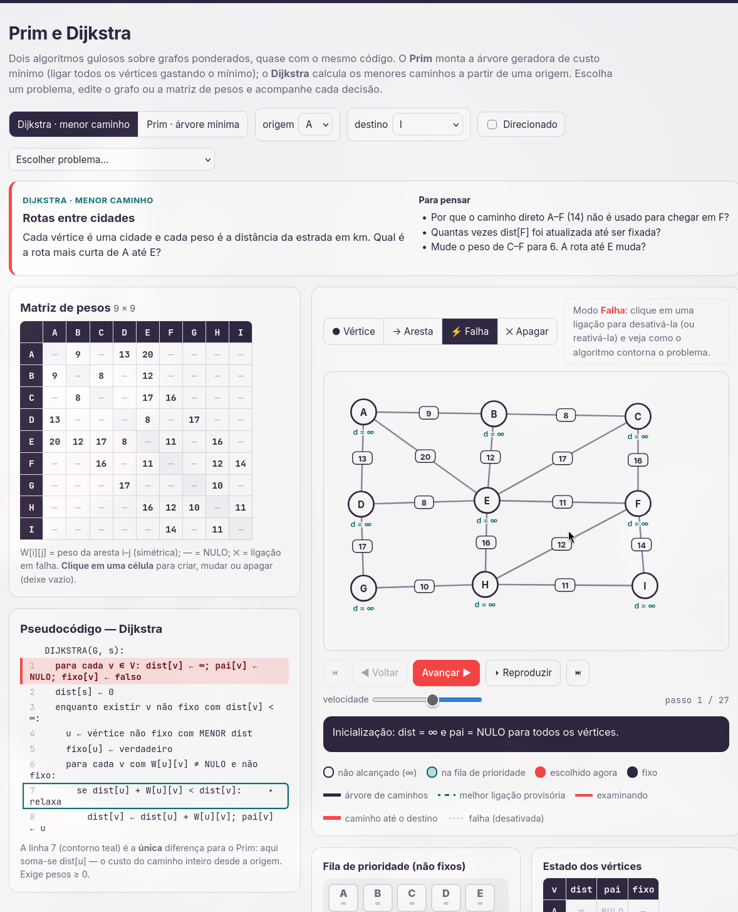
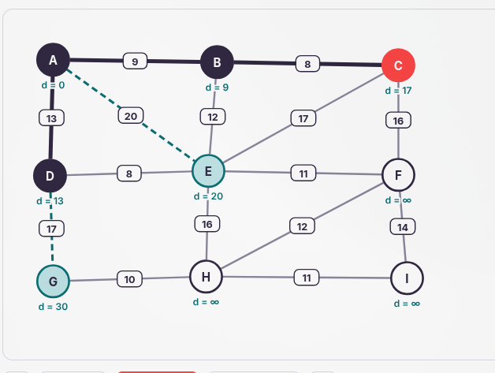

# Etapa 1 - Modelagem formal e matriz de pesos

1. Dígitos do RA e destino

| D1 | D2 | D3 | D4 | D5 | D6 |
|---|---|---|---|---|---|
| 5 | 1 | 0 | 1 | 0 | 8 |

D6 = 8 é **par** → **destino = I**. Origem = A.

2. Pesos calculados

| Aresta | Ramal | Fórmula | Cálculo | w (km) |
|---|---|---|---|---|
| e1 | (A, B) | 9 + (D1 mod 5) | 9 + (5 mod 5) = 9 + 0 | **9** |
| e2 | (A, D) | 12 + (D2 mod 6) | 12 + (1 mod 6) = 12 + 1 | **13** |
| e3 | (A, E) | 20 + (D3 mod 7) | 20 + (0 mod 7) = 20 + 0 | **20** |
| e4 | (B, C) | 7 + (D4 mod 4) | 7 + (1 mod 6) = 7 + 1 | **8** |
| e5 | (B, E) | 10 + ((D5+D6)) mod 6) | 10 + (8 mod 5) = 10 + 2 | **12** |
| e6 | (C, F) | 13 + (D6 mod 5) | 13 + (8 mod 5) = 13 + 3 | **16** |
| e7 | (D, E) | 8 + ((D1+D3) mod 5) | 8 + (5 mod 5) = 8 + 0 | **8** |
| e8 | (D, G) | 15 + ((D2+D4) mod 6) | 15 + (2 mod 6) = 15 + 2 | **17** |
| e9 | (E, F) | 11 + ((D3+D5) mod 4) | 11 + (0 mod 4) = 11 + 0 | **11** |
| e10 | (E, H) | 14 + ((D4+D6) mod 7) | 14 + (9 mod 7) = 14 + 2 | **16** |
| e11 | (F, I) | 9 + ((D1+D5) mod 6) | 9 + (5 mod 8) = 9 + 5 | **14** |
| e12 | (G, H) | 6 + ((D2+D6) mod 5) | 6 + (9 mod 5) = 6 + 4 | **10** |
| e13 | (H, I) | 10 + ((D3+D4) mod 6) | 10 + (1 mod 4) = 10 + 1 | **11** |
| e14 | (C, E) | 16 + ((D1+D2) mod 5) | 16 + (6 mod 5) = 16 + 1 | **17** |
| e15 | (F, H) | 12 + (D5 mod 7) | 12 + (0 mod 7) = 12 + 0 | **12** |

3. Diagrama topológico

4.  Matriz de pesos 9x9

5. Simulador:

# Etapa 2 - Dijsktra

2. Nessa etapa entendi que a terceira aresta seria a partir do momento que tivessem 3 arestas ja na cor mais escura, mas por preucausão anexei a imagem onde tem 3 conectadas. Ou seja abaixo tem a imagem onde tem 3 arestas ja identificadas e 4 vertices, porem entendi como se o primeiro nao fosse considerado.

# Etapa 3 - Teste

Questão 1: A distância total minima é de 45 KM e a sequencia seria A-E-F-I.

Questão 2: Derrubei o A-E,